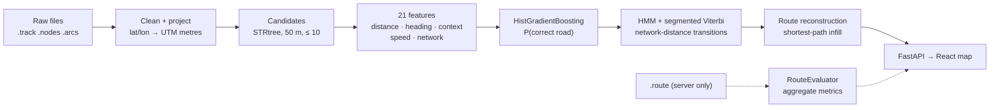

<p align="center">
  
</p>

<p align="center">
  
  
  
  
  
  
  
</p>

<p align="center">
  <b>UE24CS352A Machine Learning Hackathon</b> · PES University, Department of CSE, RR Campus<br>
  Sujal · Shriya · Sudheeksh · Shubashitha
</p>

---

**PathSnap** takes the GPS fixes a car records once per second, which are always a few metres off, and reconstructs
the exact sequence of road segments it actually drove. A machine-learning **classifier** scores every nearby road for
every fix. A **Hidden Markov Model** decoded with **Viterbi** then picks the best *drivable* sequence of roads. The
system runs as a **FastAPI** service on one laptop and a live **React + Leaflet** map on another, and the reference
routes never leave the server.

<table>
  <tr>
    <td align="center"><h2>95.9%</h2>Top-1 accuracy on the<br>10 held-out evaluator trips</td>
    <td align="center"><h2>+5.1 pts</h2>gained by HMM + Viterbi<br>over the classifier alone</td>
    <td align="center"><h2>0.994</h2>route continuity<br>(1.0 = fully drivable)</td>
    <td align="center"><h2>1070 → 12</h2>impossible road jumps<br>removed by decoding</td>
  </tr>
</table>

## See it working

<p align="center">
  <br>
  <sub>The live UI in EVALUATION mode on held-out trip 00000087: the HMM route (green) over the raw GPS (blue), with the
  metrics computed on the server: Top-1 99.1%, route continuity 100%.</sub>
</p>

<table>
  <tr>
    <td width="50%"></td>
    <td width="50%"></td>
  </tr>
  <tr>
    <td><sub><b>Why the HMM matters.</b> Real stretch of trip 00000077: deciding each fix alone gets 26 of 40 right
    (it jumps onto a side street and the wrong direction); decoding the whole sequence gets 40 of 40.</sub></td>
    <td><sub><b>Viterbi on real numbers.</b> While the car is nearly stopped the classifier prefers the opposite
    direction of the street (A); Viterbi keeps the whole sequence on the correct direction (B).</sub></td>
  </tr>
</table>

## How it works



| Stage | What happens | Code |
|---|---|---|
| **Data** | strict loaders, validation, cleaning; every trip projected into its own UTM zone (the 90 trips span 25 zones) | `src/pathsnap/data/`, `geography/` |
| **Labels** | monotone dynamic-programming alignment of fixes to the ordered `.route` (training and scoring only) | `data/labeling.py` |
| **Candidates** | Shapely STRtree query: arcs within 50 m, the 10 nearest, 150 m fallback; misses the true road for 0.2% of fixes | `features/candidate_generation.py` |
| **Features** | 21 features in 5 groups; heading alone is worth 33 Top-1 points in ablation | `features/feature_extraction.py` |
| **Models** | 8 models from 7 families, 5-fold **GroupKFold by trip** (no trip is ever split) | `models/`, `training/` |
| **Tuning** | Optuna TPE + median pruning, 40 trials on HistGradientBoosting | `optimisation/` |
| **Decoding** | HMM: classifier emissions, transitions from bounded Dijkstra driving distance, U-turn penalty, chain breaks on gaps | `decoding/` |
| **Serving** | FastAPI with request logging, timeouts, clear 404/422/503/504 errors; React + Leaflet UI | `backend/`, `frontend/` |

## HMM and Viterbi-Based Route Reconstruction

The machine learning classifier predicts the probability of each candidate road being the correct road for every GPS fix. However, selecting the highest-probability road independently for every GPS fix can result in incorrect or disconnected routes.

To overcome this limitation, PathSnap uses a Hidden Markov Model (HMM) combined with the Viterbi algorithm.

### 1. Emission Probabilities

The classifier provides probability scores for candidate roads at every GPS location. These scores act as emission probabilities and indicate how likely each candidate road is to match the observed GPS position.

### 2. Transition Scoring

The HMM evaluates whether moving from one candidate road to another is realistic. It uses bounded Dijkstra-based driving distance from the road network and applies a U-turn penalty to discourage unlikely direction reversals.

### 3. Viterbi Decoding

The Viterbi algorithm considers both emission probabilities and transition scores to identify the most likely sequence of roads across the trip. Instead of making independent decisions for every GPS fix, it finds a consistent road sequence.

### 4. Handling GPS Gaps

When large gaps occur between GPS observations, the decoder breaks the sequence into separate continuous chains rather than forcing unreliable connections between distant observations.

### 5. Final Route Reconstruction

After decoding, the selected road segments are connected using shortest-path reconstruction where required. This produces a more continuous and drivable route.

**Key Benefit:** Combining the classifier with HMM and Viterbi improves route accuracy and continuity by considering the complete sequence of GPS observations instead of making independent predictions for individual GPS points.

## Results

| Metric | Student-test · classifier | Student-test · **+ HMM** | Held-out evaluator · classifier | Held-out evaluator · **+ HMM** |
|---|---|---|---|---|
| Top-1 accuracy | 0.9000 | **0.9544** | 0.9080 | **0.9590** |
| Route continuity | 0.782 | **0.997** | 0.789 | **0.994** |
| Route F1 | 0.949 | **0.989** | 0.926 | **0.987** |
| Invalid transitions | 1108 | **12** | 1070 | **12** |

The evaluator trips were scored **once**, with the frozen model, after every modelling decision had been made
(`scripts/evaluate_heldout.py`). The held-out result matches the student-test result, so the trip-grouped
cross-validation was a reliable estimate.

<details>
<summary><b>Model leaderboard: 8 models, same features, same folds</b></summary>

| Model | CV Macro-F1 | CV Top-1 | Student Top-1 | Student log loss | ms / 1k fixes |
|---|---|---|---|---|---|
| Random Forest | 0.9336 ± 0.0144 | 0.8840 | 0.8942 | 0.0784 | 22 |
| **HistGradientBoosting** (selected) | 0.9332 ± 0.0138 | 0.8840 | 0.8950 | 0.0828 | 10 |
| Extra Trees | 0.9316 ± 0.0148 | 0.8802 | 0.8872 | 0.0836 | 27 |
| MLP (64-32) | 0.9296 ± 0.0145 | 0.8836 | 0.8868 | 0.0878 | 5 |
| Logistic Regression | 0.9262 ± 0.0159 | 0.8820 | 0.8834 | 0.1019 | 1 |
| RBF SVM (Platt) | 0.9244 ± 0.0167 | 0.8789 | 0.8789 | 0.1073 | 1151 |
| k-Nearest Neighbours | 0.9223 ± 0.0167 | 0.8711 | 0.8809 | 0.1344 | 315 |
| Gaussian Naive Bayes | 0.9013 ± 0.0118 | 0.8596 | 0.8593 | 0.4316 | 4 |

HistGradientBoosting and Random Forest are statistically tied. HGB was chosen because, untuned, it fits about 20× faster
and its file is about 300× smaller. After Optuna tuning: CV Macro-F1 0.9343, student Top-1 0.9000, log loss 0.0767.
Full tables: [`reports/final/RESULTS_SUMMARY.md`](reports/final/RESULTS_SUMMARY.md).
</details>

## Quick start

Requires Python 3.10+ (tested on 3.12) and Node.js 18+.

```powershell
git clone https://github.com/Shriya-sr/ML-Hackathon.git PATHSNAP
cd PATHSNAP
python -m venv .venv
.\.venv\Scripts\python.exe -m pip install -r requirements-dev.txt
.\.venv\Scripts\python.exe -m pip install -e .
cd frontend; npm.cmd ci; cd ..
```

Put the course data in `data/raw/` (`train/`, `student_test/`, `evaluator_test/`; see [`data/README.md`](data/README.md))
or point `PATHSNAP_DATA_DIR` at it. The trained model is already in `artifacts/`, so you can run the system straight away:

```powershell
.\.venv\Scripts\python.exe -m backend.main          # Laptop 1: API on http://0.0.0.0:8000 (docs at /docs)
```

```powershell
cd frontend
Set-Content -Encoding ascii .env.local "VITE_API_URL=http://<LAPTOP-1-IP>:8000"
npm.cmd run dev                                      # Laptop 2: open http://localhost:5173
```

With trips in `data/raw/evaluator_test/` the API runs in **EVALUATION** mode; otherwise it serves the student-test
trips in **DEVELOPMENT** mode. Two-laptop setup, firewall rule and troubleshooting: [`docs/deployment.md`](docs/deployment.md)
and the step-by-step sheets for [Laptop 1](docs/LAPTOP1_BACKEND_COMMANDS.md) and [Laptop 2](docs/LAPTOP2_FRONTEND_COMMANDS.md).

<details>
<summary><b>Reproduce every experiment</b></summary>

```powershell
python scripts/run_eda.py                       # inventory, data quality, EDA figures            (~5 min)
python scripts/build_features.py --jobs 6       # candidates + features for train / student-test (~2 min)
python -W ignore scripts/train_all.py --fresh   # 8 models, 5-fold trip-grouped CV + student test (~40 min)
python scripts/feature_analysis.py              # permutation importance + group ablation          (~10 min)
python -W ignore scripts/optimise.py            # Optuna TPE on HistGradientBoosting               (~25 min)
python scripts/tune_hmm.py                      # decoder grid on training trips (out-of-fold)     (~10 min)
python scripts/evaluate_all.py                  # classifier-only vs HMM on student-test           (~2 min)
python scripts/evaluate_heldout.py              # final held-out score on the evaluator trips (once)
python scripts/generate_maps.py                 # Folium maps
python scripts/make_report_figures.py           # model comparison figures
python scripts/make_explainer_figures.py        # explanatory figures + README banner
python scripts/build_report.py                  # technical report PDF
```

Seeds are fixed (42). `python scripts/run_all.py` runs the whole development pipeline in order. The held-out
evaluation is deliberately left out of it: it is run once, by hand, with the frozen model.
</details>

<details>
<summary><b>API endpoints</b></summary>

| Method | Endpoint | Purpose |
|---|---|---|
| GET | `/health` | liveness, model loaded, mode, trip count |
| GET | `/api/system/info` | EVALUATION / DEVELOPMENT mode, partition, versions |
| GET | `/api/model/info` | model variant, feature schema, CV score, HMM parameters |
| GET | `/api/trips` | the trips available for evaluation (no labels) |
| GET | `/api/trips/{id}/metadata` | fixes, duration, bounding box, network size, gaps |
| POST | `/api/predict/{id}` | run the full pipeline: route, per-fix decisions, flags, timings, server-side metrics |
| GET | `/api/results/{id}` | last result for a trip |
| GET | `/api/results/{id}/explain/{fix}` | candidates, probabilities and key features for one fix |

Reference routes are read only by the server-side `RouteEvaluator`, and responses carry aggregate metrics only
(enforced by `backend/tests/test_api.py::test_no_ground_truth_leakage`).
</details>

## Tests

```powershell
.\.venv\Scripts\python.exe -m pytest -p no:warnings   # 92 tests: unit, edge cases, API, real-trip integration
cd frontend; npx vitest run; npx tsc -b               # 12 UI tests + type check
```

Covered: malformed, missing and empty files; invalid coordinates and timestamps; candidate edge cases; feature-schema
checks; Viterbi checked against brute force; route metrics; every API error code; concurrent requests; ground-truth leakage.
Clean-clone reproduction: [`docs/acceptance_tests.md`](docs/acceptance_tests.md).

## Repository layout

```
PATHSNAP/
├── src/pathsnap/        Python package: data, geography, features, models, training, evaluation,
│                        optimisation, decoding (HMM/Viterbi), inference, visualisation
├── backend/             FastAPI app: routers, services, schemas, tests
├── frontend/            React + TypeScript + Vite + Leaflet evaluator UI
├── scripts/             reproducible drivers: EDA → features → training → tuning → HMM → maps → report
├── configs/             every setting: data, features, models, HMM, optimisation, API
├── artifacts/           final classifier + metadata (feature schema, HMM parameters)
├── experiments/         per-model results, CV folds, Optuna study and trials, logs
├── reports/             technical report (PDF), EDA outputs, figures, results summary, leakage audit
├── maps/                interactive Folium maps (html) + screenshots
├── tests/               unit, edge-case and integration tests
└── docs/                methodology, architecture, deployment, data dictionary, audits
```

## Documentation

| Document | Where |
|---|---|
| 📄 **Technical report** | [`reports/technical_report/PathSnap_Technical_Report.pdf`](reports/technical_report/PathSnap_Technical_Report.pdf) |
| 🧭 Methodology | [`docs/methodology.md`](docs/methodology.md): labelling, candidates, features, CV, metrics, HMM, leakage controls |
| 🤖 Per-model answers | [`docs/model_explanations.md`](docs/model_explanations.md) |
| 🏗️ Architecture · data dictionary | [`docs/architecture.md`](docs/architecture.md) · [`docs/data_dictionary.md`](docs/data_dictionary.md) |
| 🔒 Data-leakage audit | [`reports/final/DATA_LEAKAGE_AUDIT.md`](reports/final/DATA_LEAKAGE_AUDIT.md) |
| ✅ Requirements and tests | [`docs/requirements_traceability.md`](docs/requirements_traceability.md) · [`docs/deliverable_audit.md`](docs/deliverable_audit.md) · [`docs/acceptance_tests.md`](docs/acceptance_tests.md) |
| 🗺️ Interactive maps | [`maps/html/`](maps/html/) |

## Team

| Sujal | Shriya | Sudheeksh | Shubashitha |
|---|---|---|---|
| backend, deployment, testing | data, preprocessing, features | models, CV, Bayesian optimisation | HMM / Viterbi, maps, UI |

Details: [`TEAM.md`](TEAM.md).

## AI-assistance disclosure

This project was built with substantial help from an AI coding assistant, under the team's direction.

<details>
<summary>Provenance of the experiment records</summary>

The JSON records in `experiments/` cite `git_commit: be932cd` with `git_dirty: true`. They were produced from the working
tree while the review-1 checkpoint commit was HEAD, and committed in `efefb9b`. The commit history was later rewritten to
change commit messages only (authorship), so `be932cd` appears on GitHub as `e0fec1f` with an identical file tree. A clean
clone rebuilt the features, retrained logistic regression and HistGradientBoosting, and reproduced their recorded scores
exactly ([`docs/acceptance_tests.md`](docs/acceptance_tests.md) §3). An earlier exploratory implementation is kept
unchanged on the `sudeeksh` branch; its own notes say its first results were invalidated by an alignment bug, so none
of them are reported.
</details>
